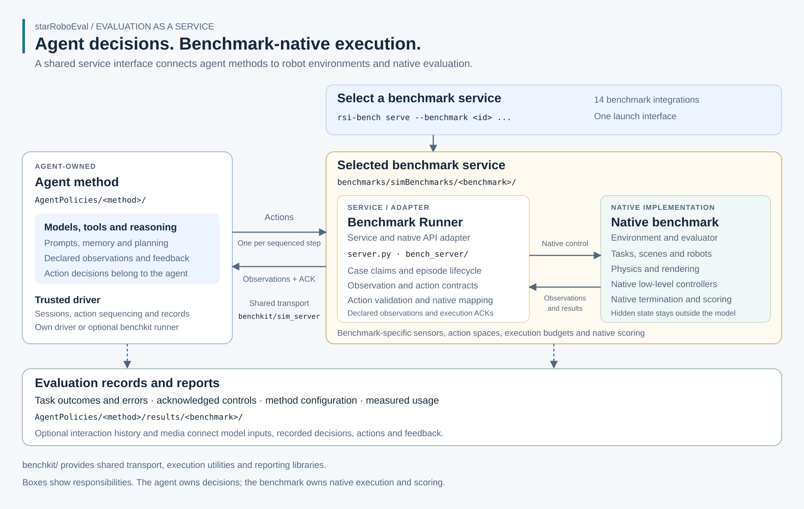
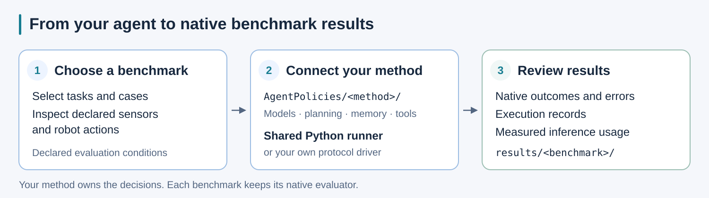

<p align="center">
  
</p>

# starRoboEval: A Unified Embodied Benchmark Integration for Agentic Robotics
**Connect your agent to robot benchmarks through a common service interface.**

starRoboEval brings **14 simulation benchmark integrations** into one evaluation
workflow. Choose a benchmark, connect your agent method, and collect results
from the benchmark's native evaluator. Each integration retains its own robot
observations, action space, task conditions and scoring.

[Core idea](#evaluation-as-a-service) · [Benchmarks](#choose-a-benchmark) · [Quick start](#quick-start) ·
[Connect your agent](#connect-your-agent) · [Documentation](#documentation) ·
[Evaluation article](#research-and-results)

## Evaluation as a Service

Robot benchmarks come with different simulators, assets, robot interfaces and
evaluators. starRoboEval packages these behind services with a common
communication and episode lifecycle protocol. The service manages the task
environment, executes robot actions and collects native outcomes. Your agent
method owns its models, prompts, planning, memory, tools and action decisions.

- **Credible agentic evaluation.** A declared interface defines what the agent
  can observe and execute. Simulator internals, reset controls and private
  scores stay on the evaluator side, while the agent can plan and compute
  using the information available to it.
- **Sim / Real interaction alignment.** Interfaces describe robot observations,
  controls and execution feedback, establishing a common boundary for future
  hardware integrations. Real-robot services are a planned extension.
- **Reusable evaluation infrastructure.** Connect different agent methods to
  the same benchmark service. Shared communication, lifecycle and result tools
  reduce repeated integration work while preserving benchmark-specific tasks,
  robot interfaces and native scoring.



The action loop connects the agent method to the benchmark service. Shared
libraries provide transport, execution utilities and reporting; methods can use
the supplied driver or implement the service protocol themselves. See the
[architecture](docs/architecture.md) for component responsibilities and the
[agent integration guide](docs/agent-methods.md#add-your-policy) for implementation details.

## Choose a benchmark

Explore **14 simulation benchmark integrations** spanning tabletop and bimanual
manipulation, household tasks, humanoid control and navigation. Each benchmark
name below links to its setup and service guide.

The results show the **Native GPT-6-Astra Policy** on the evaluation selections
reported in our article. Success is determined by each benchmark's native
evaluator.

| Benchmark | Evaluation selection | Success / cases | Success rate |
| --- | --- | ---: | ---: |
| [SimplerEnv](benchmarks/simBenchmarks/SimplerEnv/README.md) | 15 tasks × 5 episodes | 20 / 75 | **26.7%** |
| [LIBERO](benchmarks/simBenchmarks/LIBERO/README.md) | 4 suites × 10 tasks × 5 initial states | 69 / 200 | **34.5%** |
| [CALVIN](benchmarks/simBenchmarks/calvin/README.md) | 34 individual tasks × 5 episodes; budget: 240 controls | 140 / 170 | **82.4%** |
| [MetaWorld](benchmarks/simBenchmarks/MetaWorld/README.md) | 50 tasks × 5 episodes | 178 / 250 | **71.2%** |
| [RoboDojo](benchmarks/simBenchmarks/RoboDojo/README.md) | 42 tasks × 5 layouts | 42 / 210 | **20.0%** |
| [RoboCasa365](benchmarks/simBenchmarks/Robocasa_365/README.md) | 50 atomic and composite tasks × 5 episodes | 57 / 250 | **22.8% overall** |
| [RoboCasa Tabletop](benchmarks/simBenchmarks/Robocasa_tabletop/README.md) | 24 tasks × 2 episodes; budget: 1,000 controls | 6 / 48 | **12.5%** |
| [RoboTwin](benchmarks/simBenchmarks/Robotwin/README.md) | 50 tasks × 5 episodes, clean scenes | 43 / 250 | **17.2%** |
| [BEHAVIOR](benchmarks/simBenchmarks/Behavior/README.md) | 6 household tasks × 5 episodes | 3 / 30 | **10.0%** |
| [SIMPLE](benchmarks/simBenchmarks/SIMPLE/README.md) | 12 whole-body tasks × 5 episodes | 28 / 60 | **46.7%** |
| [VLA-Arena](benchmarks/simBenchmarks/VLA-Arena/README.md) | 170 tasks across L0–L2 × 5 episodes | 546 / 850 | **64.2%** |
| [LIBERO-Plus](benchmarks/simBenchmarks/LIBERO-plus/README.md) | 40 tasks with 7 perturbation types | 598 / 1,396 | **42.8%** |
| [DOMINO](benchmarks/simBenchmarks/DOMINO/README.md) | 35 tasks × 5 selected episodes | 41 / 175 | **23.4%** |
| [VLN-CE](benchmarks/simBenchmarks/VLN-CE/README.md) | 373 R2R val_unseen episodes across 11 scenes | 314 / 373 | **84.2%** |

RoboCasa365's atomic subset is **33.3%** (30/90); the table shows its overall
selection. DOMINO uses all 175 selected cases, including four infrastructure
interruptions. Each result retains its reported case selection and execution
conditions.

See the [detailed results (article draft)](https://github.com/starVLA/starvla.github.io/blob/preview/blog-migration-20261116/public/blogs/starRoboEval/scores.html)
for task breakdowns and additional native metrics. The
[service support table](benchmarks/simBenchmarks/SERVICE_SUPPORT.md) describes
the selections and deployment requirements available in the current code.

## Quick start

**[Run your first evaluation with RoboCasa365 →](docs/quickstart.md)**

The walkthrough covers environment setup, starting a benchmark service,
connecting the reference agent and opening the result report.

## Connect your agent

**Bring your own method, keep your decision loop, and evaluate through the
same benchmark services.** Your method can combine general-purpose models,
planning, memory and tools over the observations declared by the benchmark.
It selects robot actions; the service executes them through native low-level
controllers and evaluates the outcome.



Create **`AgentPolicies/<your_method>/`** for your implementation, configuration
and README, or connect an existing agent from its own repository. Two integration
paths are available:

| Starting point | What you implement | What you reuse |
| --- | --- | --- |
| **A Python policy** | Your observation-to-action logic, method configuration and entrypoint | The optional shared runner for action sequencing, episode closure and result records |
| **An existing agent or another language** | Your decision loop and a driver implementing the service protocol | The benchmark services, declared robot interfaces and native evaluators |

The service describes its observations and action contract. Your trusted driver
handles credentials and episode administration, sends the agent's actions and
returns declared observations and execution feedback to it. Record the method
settings and available inference usage alongside native results so experiments
can be compared under explicit conditions.

**[Add your method →](docs/agent-methods.md#add-your-policy)** ·
[GPT-6-Astra reference client](AgentPolicies/gpt6_astra/README.md) ·
[Claude reference client](AgentPolicies/claude_opus/README.md) ·
[Service protocol](benchmarks/simBenchmarks/SERVER_PROTOCOL.md)

## Research and results

Our first evaluation asks **how far a general-purpose model can control robots
with one generic agent setup and no benchmark-specific task-solving prompt**.
The Native GPT-6-Astra Policy uses the service interfaces to act across the
14 integrations above.

The detailed results reveal more than a single success rate:

- **Navigation across unseen scenes.** On the selected VLN-CE episodes, the
  policy succeeds on **314/373** routes with **0.72 SPL** (success weighted by
  path length), covering all 11 evaluation scenes.
- **Atomic and composite kitchen tasks.** RoboCasa365 records **30/90** successes
  on atomic tasks and **27/160** across the two composite task sets. These give
  **33.3% atomic** and **22.8% overall** success.
- **Task progress alongside completion.** BEHAVIOR records **10.0%** success and
  **0.27 mean Q**, its native task-progress score on a 0–1 scale. The article
  presents partial progress separately from success.

The article also includes evaluation recordings, observation–action replays,
published reference results and inference-cost summaries. These views connect
the scores to what the agent saw, the actions it chose and the resources it used.

**[Read the evaluation article (draft source) →](https://github.com/starVLA/starvla.github.io/blob/preview/blog-migration-20261116/public/blogs/starRoboEval/index.html)** ·
[Browse detailed results](https://github.com/starVLA/starvla.github.io/blob/preview/blog-migration-20261116/public/blogs/starRoboEval/scores.html)

## Documentation

We provide guides for running evaluations, connecting agent methods and adding
benchmarks. Start with the guide that matches what you want to do.

| I want to… | Guide |
| --- | --- |
| Run a first evaluation | [RoboCasa365 quick start](docs/quickstart.md) |
| Connect my agent | [Method integration](docs/agent-methods.md#add-your-policy) · [Reference clients](AgentPolicies/README.md) |
| Understand the service design | [Architecture](docs/architecture.md) · [Communication protocol](benchmarks/simBenchmarks/SERVER_PROTOCOL.md) |
| Select cases and run experiments | [Evaluation workflow](docs/evaluation.md) · [Task selection](benchmarks/simBenchmarks/TASK_COVERAGE.md) |
| Inspect results and interaction records | [Reports](docs/evaluation.md#inspect-and-report) · [Recording](docs/recording.md) · [Result format](docs/result-format.md) |
| Add a benchmark integration | [Integration guide](docs/benchmark-server-guide.md) · [Service conventions](benchmarks/simBenchmarks/SERVICE_CONVENTIONS.md) |

## Citation

If you use starRoboEval or its evaluation results, please cite our evaluation report:

```bibtex
@misc{starvla2026starroboeval,
  author = {{StarVLA Community}},
  title = {What Does {GPT-6-Astra} Score When Nothing Is Tailored to a Benchmark?},
  year = {2026},
  url = {https://starvla.github.io/blogs/starRoboEval/}
}
```

## Attribution and license

Part of the [StarVLA](https://github.com/starVLA/starVLA) ecosystem and derived
from its codebase. Released under the [MIT license](LICENSE).
The [upstream StarVLA citation](https://github.com/starVLA/starVLA/blob/main/CITATION.cff)
is separate from the starRoboEval evaluation report above.
