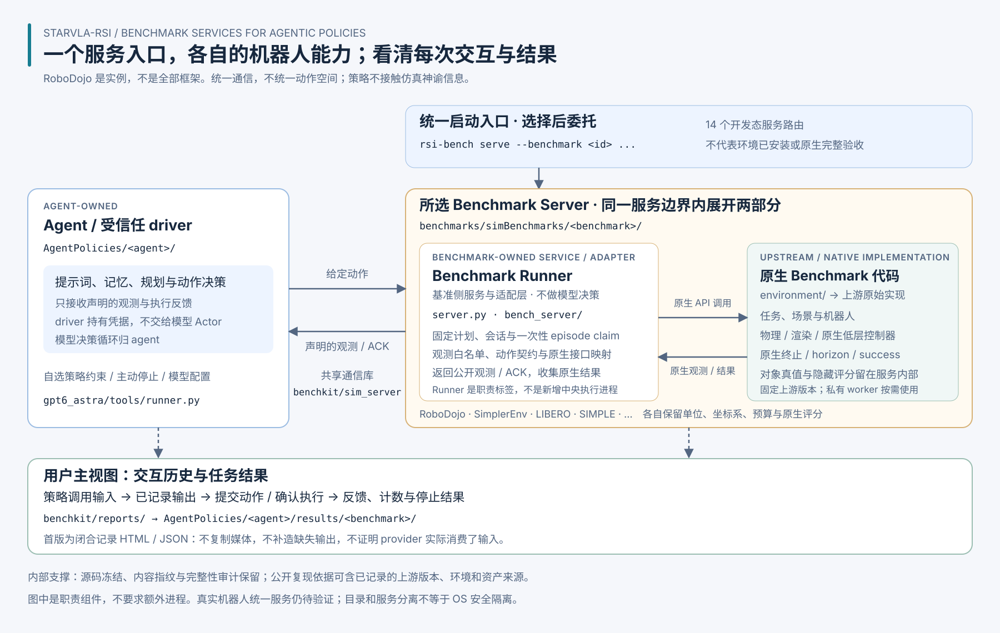

# Architecture

The unit of evaluation is a complete **agent method**, including its model
composition, prompts, tools, memory and decision behavior. A fixed-prompt model
baseline is one method, not the only integration shape. Compare results within
declared benchmark/protocol conditions, with inference cost disclosed rather
than constrained by a new universal budget. See [method integration](agent-methods.md).

The SIM-server boundary prohibits oracle access; it does not impose an RGB-only
policy. A versioned benchmark interface may explicitly provide measured robot
joints, end-effector poses and other declared robot sensors. That permission
does not include object ground truth, private reset layouts, hidden task scores
or hypothetical simulator rollouts. Sensor/action track selection stays with
the benchmark; model prompts, memory and target selection stay with the agent.

The primary architecture has two control ends: an agent-owned evaluation driver
and a benchmark-owned SIM service. `benchkit` provides shared communication and
output/data libraries, not a third mandatory control process. These are responsibility boundaries, not an OS
sandbox. The trusted driver retains the administrative client; the model actor
receives only declared observations and execution counters. The benchmark
service alone owns native environments. See the [SIM service protocol](../benchmarks/simBenchmarks/SERVER_PROTOCOL.md).

Current source roots are `benchmarks/`, `AgentPolicies/` and `benchkit/`.
See [package migration](package-migration.md) for new launch paths and the
unchanged treatment of frozen packages, historical results and ignored local files.

## One entrypoint, benchmark-specific capabilities

`rsi-bench list` shows the 13 implemented development service routes.
`rsi-bench serve --benchmark <id> ...` selects one and delegates to its existing
`server.main(argv)`. The source-checkout equivalent is
`python -m benchkit.sim_server.cli`. The selector is a launch convenience, not a
new decision loop, proxy or persistent coordinator. Generic list/help needs no
simulator; selected-service help shows that wrapper's real launch options.
The old `python -m benchkit.sim_server` remains a synthetic diagnostic only.

RoboDojo, SimplerEnv, LIBERO and SIMPLE share communication mechanisms, not a
single action space. In particular, SIMPLE's humanoid contract is not EEF16.
The selected adapter owns sensors, action semantics, task panel and scoring.
VLN-CE and hardware are not listed as available service routes. An implemented
route does not prove asset readiness or full native validation.

`EvaluationRunner` is not the server layer. The reusable runner lives on the
**agent side**; benchmark services execute
given actions and return declared observations. Shared report tools sit beside
this control path.

## Ownership

| Layer | Owns | Must not own |
| --- | --- | --- |
| `AgentPolicies/<profile>/` | Policy factory, model configuration, prompts, decisions, trusted evaluation entrypoint and results | Native simulator handles or task/scoring definitions; oracle information in model requests |
| `benchmarks/simBenchmarks/<benchmark>/` | Native environment, task inventory, observation/action mapping, scoring and sample-selection plans | Model prompts, task-solving heuristics or model-specific persistence requirements |
| `benchkit/` | Service selection, shared transport, central case scheduling, records/reports and internal integrity tools | Native task semantics or model inference/robot decisions |

Real-robot integrations belong under `benchmarks/realRobots/`. Existing SDK and
hardware bridge references do not enable unattended robot execution.

### Central scheduling stays; agent decisions stay local to the method

`benchkit/campaigns/` retains central task organization in this version: assemble a
benchmark-provided fixed plan, freeze it, claim an unattempted case, launch it and
summarize progress. An operator selects the case and device. It is not an
additional per-action intermediary between the agent and benchmark server.

The current campaign commands cover five registered plans and launch their
frozen **local adapter** path. They do not yet schedule the thirteen remote
service routes. Server selection (`rsi-bench`) and campaign execution are two
distinct entrypoints, not sequential steps of one integrated remote workflow.
See the [workflow choices](evaluation.md#choose-a-workflow).

Resource-aware multi-service scheduling and restart reconciliation are future
extensions. Keep benchmark schedules and permanent attempt claims authoritative;
never replay uncertain controls or silently retry failed cases. A new run ID
alone is not permission to repeat a task.

### Benchmark interface

`BenchmarkAdapter` declares compatible observation/action contracts and selects
episodes. `EpisodeSession` implements observation delivery, control execution,
native metrics, artifacts and cleanup. Only this side can access private native
state; the policy receives a whitelisted public observation.

Each implemented benchmark service provides a top-level `server.py` entrypoint
and groups service implementation and protocol under `bench_server/`: the adapter
and private worker client sit beside the `protocol/` subpackage, which contains
task definitions and public feedback schemas. Native runtime code stays under
`environment/`. Its catalog is benchmark protocol data, while deployment
paths and the selected named panel are server configuration. See the
[RoboDojo directory guide](../benchmarks/simBenchmarks/RoboDojo/README.md#directory-responsibilities).
All implemented services use only `bench_server.adapter`; their old root
adapter imports are removed. Separate protocol packages exist where definitions
are needed, not as empty layers. Task catalogs are immutable protocol data,
not assets or deployment paths; no task-specific server copy is required.
Their actions remain benchmark-native. The model-owned
[`codex_native` (`codex-native/v2`)](../AgentPolicies/gpt6_astra/README.md)
validation client supplies numeric vectors in the service-declared action space.
It preserves the former Direct v3 behavior without applying the historical
Dojo-specific EEF method.
The shared
`benchkit/sim_server/` transport provides a remote `BenchmarkAdapter`, fixed
server schedules, single-attempt session claims, serialized control and bounded
hash-checked artifact transfer. It has no task-solving methods. Server credentials
and management/scoring methods are evaluator-private; policies retain exactly
the same observation-to-decision interface. Idle service time does not schedule
native control. Lost step acknowledgments never trigger automatic replay.

The model-owned `AgentPolicies/gpt6_astra/run.py` entrypoint requires `--sim-server`
and uses the reusable loop in `AgentPolicies/gpt6_astra/tools/runner.py`. It has no local
native fallback. This trusted driver is distinct from the model actor: the
administrative client includes schedules, metrics and result export, and must
not be passed to an untrusted policy process. The legacy standalone CLI also
supports `--sim-server`. Existing frozen campaigns still
use their original in-process/worker path; remote campaign source/schedule binding
is not implemented. Service deployment source and client source are recorded
separately, without claiming loaded-memory, asset or provider attestation.

Unit conversion, fixed joint order, protocol-defined interpolation and native
low-level control belong to the adapter. Object localization from images,
grasp planning, trajectory selection and model-specific IK belong to the policy.
VLA action proposals, hybrid controllers, fallback task policies and autonomous
task-skill services are outside this repository's direct-control scope. Native
low-level control and protocol-fixed conversions must not plan the task for
the model or silently expand its available observations.

For SimplerEnv, LIBERO, SIMPLE, RoboCasa365 and RoboCasa Tabletop,
`bench_server/protocol/plan.py` holds benchmark-specific campaign selection and
required runtime resources. No active `evaluation/` package remains in these
services. Standalone fast services may instead
declare their fixed schedule in the adapter; a service does not imply a frozen
campaign plan exists. RoboDojo's server instead reads the immutable schedule from
`bench_server/protocol/task_catalog.json`: `classify_objects` has a five-layout `fast` panel
and a 50-layout `full` panel. Both attempt each selected layout once; neither
covers every RoboDojo task. The shared campaign assembler registers plans without
implementing their task semantics. Full support remains benchmark-specific.

### Policy interface

The wire protocol is the integration boundary; no language, SDK or Python base
class is mandatory. The optional `Policy.act` interface receives one scheduled observation and returns one structured action
chunk or stop. It has no direct reset/step API. Model behavior, prompt construction
and optional voluntary-stop preferences are versioned under the selected profile.
One call may involve multiple declared general-purpose model components. Their
usage is separate from decision-call/control counters. The method and accounting
versions are explicit; old frozen one-request records keep their original audit.

The method owns action chunk length, how many controls to execute from a decision
(including repeated targets), and when to replan. The trusted agent driver sends
these as successive single-action `step` requests; the service has no decision
boundary or universal five-control prefix. Each request still obeys sequencing,
action validity, native control/termination and the declared total execution
budget. Repeating a target means another acknowledged control, never replaying
an uncertain request. Native physics substeps, timing and protocol-fixed
interpolation remain benchmark-owned, not method-adjustable repeats.

This ownership rule does not mean every existing track is already decoupled.
Legacy `budget_mode=decisions` tracks still bind call/prefix settings to a total
execution cap, and the reference runner checks agreement with the adapter.
Existing `required_replan_interval` observation-interface declarations also
remain enforced. Those contracts need explicit migration before changing them;
this clarification changes no adapter version, native budget or policy preset.

Input validity belongs to the declared benchmark interface; optional motion and
gripper preferences belong to the model profile. A declared `feedback` mode can
reject invalid input before execution and return a bounded, public validation
issue to the next normal policy call using the last acknowledged observation.
It neither advances the simulator nor supplies a fresh observation. Calls and
rejections are counted separately from executed decisions and controls, with a
finite call budget. A lost acknowledgment or uncertain native execution remains
an error, never an invitation to replay. See [action validation](../benchmarks/simBenchmarks/RoboDojo/ACTION_VALIDATION.md).

For example, requiring 50 executed action decisions before ordinary give-up is
an optional policy setting. It does not change success, the native horizon or
another model's behavior. The runner supplies non-privileged execution counters;
the policy validates its preference. Native termination, hard limits, errors and
declared safety stops can still end earlier.

The mailbox implementation lives in `AgentPolicies/anonymous_code_agent/`. Its endpoint
allocator is a preparation tool, not benchmark code.
`AgentPolicies/gpt6_astra/tools/stop_rules.py` supplies reusable opt-in stop rules
for GPT and the anonymous mailbox; each profile declares its own preferences. Shared fixed-action fixtures live under
`benchkit/diagnostics/`: implementing the `Policy` interface does not make an
infrastructure diagnostic a participant model.

### Reusable execution and output tools

`benchkit/contracts.py` and `interfaces.py` define the public types.
`registry.py` and `campaigns/benchmark_plans.py` explicitly assemble extensions.
`AgentPolicies/gpt6_astra/tools/runner.py` validates compatibility and executes the
agent's bounded action prefixes for the model driver and general CLI. It uses recording/source tools without moving
the decision loop into `benchkit`. Native validation and end conditions remain
authoritative on the server. `benchkit/sim_server/` is the single shared transport
implementation, imported directly by both ends; there is no forwarding service
package under `benchmarks`. Import the optional runner directly from
`AgentPolicies.gpt6_astra.tools.runner`; the former benchkit runner bridge is removed.
`benchkit/campaigns/workflow.py` freezes plans and creates permanent attempt claims;
the public command is `python -m benchkit.campaigns`, not the old singular module.
`model_profiles.py` validates configured factories and captures bounded model
sources; it does not implement a provider.

Shared serializable DTOs, registry/campaign assembly and factory dispatch helpers
remain under `benchkit` for existing integrations. They are grouped into functional
packages; relocated entrypoints do not retain forwarding shells. New model
drivers construct their own model; shared declarative validation and capture
remain output/provenance tools. Frozen historical sources and results keep
their original paths and semantics.

Direct profiles declare a bounded scalar configuration schema inside their model
folder. The benchkit validates captured schema/config bytes without importing
frozen model code. The profile's factory selects model-owned request and parsing
code; direct campaigns omit mailbox endpoints. The GPT profile contains one
Bench Server validation client: `codex_native`, identified as `codex-native/v2`.
Its policy/factory sits beside `run.py`. The single
method configuration, prompt and registration declarations live under `configs/`;
runtime and transport helpers live under `tools/`. Factory and driver use the same method,
with no alternate active selection. The driver requires an explicit benchmark;
`--control-method` is optional and accepts only `codex-native/v2`.
New `campaigns prepare` requests for this method are rejected before outputs are
created: the retained local path does not satisfy its horizon/feedback contract.
Use the service driver; historical direct campaigns keep their frozen runtime.
Typed call errors preserve known usage/receipt data without creating an action.
This method retains Direct v3's persistent-turn recovery, including at most nine
continuations after definitively closed `serverOverloaded` failures, with a
30-second delay. Separate network recovery does not authorize a reset or replay
of uncertain control. Exhaustion is an infrastructure interruption, not native
task failure. These are model-owned settings, not benchmark scoring rules.

The active `codex-native/v2` keeps a persistent app-server conversation and local
analysis tools. Its action tool yields to the existing agent-side runner;
execution feedback is queued and sent only in the next counted policy call.
Only public robot observations enter its workspace. SIM credentials, scoring
and native handles stay in the trusted driver/server. Termination cancels the
model without an unmetered final continuation. See [client README](../AgentPolicies/gpt6_astra/README.md).

The client reads the service-declared action specification, arbitrary camera/state
channels and acknowledged action prefixes. Its first public observation supplies
an episode-local reference for task-required physical return, never an automatic
home trajectory or reset. It has no fixed robot, EEF format or benchmark protocol
selector. `tools/persistent_runtime.py` supplies conversation mechanics for the
one active policy; there is no multi-method policy inheritance chain. Image previews remain optional at a default longest edge of
480 pixels, with original public RGB available. Raw schema-specific robot
feedback and full evaluation documents are not automatically delivered to the
actor. Historical Direct v2's Dojo feedback and handling guidance are a distinct
method and retain their original results.

Do not conflate the three versioned contracts:

| Contract | Current example | Owns |
| --- | --- | --- |
| Shared wire protocol | `starvla-rsi.sim-server/v1` | Authenticated requests, sessions, sequencing and closed artifacts |
| RoboDojo robot interface | `robodojo-direct-v2-rgb-proprio28-eef16-robot-feedback-v1` | Declared sensors, EEF actions, fixed native conversion and scoring |
| GPT method | `codex-native/v2` | Public-input projection, prompt, tools, memory and action choices |

The method can use the existing Dojo interface without changing its version.
That compatibility is not evidence of equal success rates with the historical
Direct v2 method. Current `codex-native/v2` retains Direct v3's default of no
voluntary `safety_stop`; opting in is model configuration, not a benchmark or hardware rule.
It is distinct from the removed bounded CLI method `codex-native/v1`. All historical
methods and results retain their original identities and source inventories.

A profile can declare `runtime_preflight: true` in its captured configuration
schema. Its optional `preflight_runtime()` capability checks local dependencies
and credential presence without a benchmark, model request or action. The benchkit
dispatches this model-owned check in the frozen runtime before claiming a case;
it does not contain provider-specific readiness logic. Packages without the
declaration retain their historical behavior. Auditors read the declaration as
data and never execute the hook.

`benchkit/diagnostics/` contains explicitly non-capability fixed-action diagnostics.
They are included in benchkit source snapshots. Their recorded native metrics
validate infrastructure and must not be interpreted as model capability scores.
Benchmark-specific asset, renderer and control readiness tools remain
under that benchmark's `environment/` directory.

Generic auditing and reporting live under `benchkit/audits/` and `reports/`.
Benchmark-specific evidence checks stay beside the benchmark. An audit validates
records, not native replay, model identity or process isolation.

## Execution and records

The existing campaign/reference workflow below includes internal source freezing
and its verification gates. Those steps are not protocol-first participation or
basic-report admission requirements for an independent driver.

1. Resolve a benchmark plan and compatible policy configuration.
2. Freeze selected cases, budgets, effective prompt and declared source files.
3. Validate the frozen package; run any declared local runtime preflight, recheck
   frozen source and plan, then atomically claim a previously unattempted case.
4. Deliver an allowed observation, accept one policy decision and execute its
   bounded prefix. Repeat until native end, policy stop, error or a hard limit.
5. Close the environment and retain native outcome, errors, counters and available
   usage; retain interactions and media according to the selected recording options.
6. Show closed outcomes and optional interaction history under the selected method's
   results; run internal source/evidence audits separately when needed.

One call is not necessarily one action decision, control or physics tick. Stop
responses consume a call but execute no action. An action decision counts after
at least one control executes. Adapter-specific physics substeps remain separate.

## Basic results and optional interaction history

[`reports/basic_result.py`](../benchkit/reports/basic_result.py) produces a compact
HTML/JSON result from the closed manifest, status, episode results and summary.
No events, videos, source snapshot or full hash audit is required. It shows the
selected denominator, failures/errors, method/model composition and measured
usage. This checks supplied records, not native execution or provider identity.
There is no cross-benchmark aggregate leaderboard in this version.

Detailed recording is optional and enabled by default. The reference driver
supports `standard`/`minimal` and granular retention switches; see
[recording scope and limitations](recording.md). Disabling them does not change
live agent input, native execution, score or publication eligibility. Client
retention does not turn off native-server capture. Internal source/configuration
snapshots remain separate from runtime interaction recording.

The default permanent visual record is the native camera video retained on the server,
when the adapter produces it; shared transport does not synthesize missing videos.
Clients retain references rather than duplicate media downloads. Frame images
remain available during execution. After successful native finalization/close,
eligible frames are removed only when nonempty, hash-stable video files meet the
declared-camera count check. Otherwise frames remain as fallback evidence with a
warning. This check does not attest decoding or camera/frame correspondence;
explicit frame retention and media downloads are opt-in. Historical records are unchanged.

[`reports/interaction_history.py`](../benchkit/reports/interaction_history.py)
exports a closed client run to standalone HTML and allowlisted JSON. It groups
events by policy call: reset/latest acknowledged observation supplied to
`Policy.act`, recorded output, proposed chunk, acknowledged controls, rejection
and termination. It also includes recorded action/state semantics and counters.
A control observation is not necessarily an additional model input; unattempted
action suffixes are not uncertain execution. Unrecorded rejected vectors cannot
be reconstructed from a chunk length.

The view's planned/unattempted counts cover the client-selected schedule in its
manifest. That can be a prefix of a larger service panel; this view alone does
not establish a full server or native-suite denominator.

This first view does not copy media, recover raw conversations or prove a
provider consumed an observation. It displays camera names and explicitly says
that pixels are not included. Unknown feedback schemas remain unexpanded.
Arbitrary native info, metadata, raw exceptions and provider receipts are not
forwarded into the public view. Users should still review task text and policy
notes before publishing their content.

Useful reproducibility information includes the recorded protocol, upstream Git
revision, native environment/controller and asset origin, where actually saved
in a supported format. These are not inferred from today's checkout. The
generic viewer initially exposes a bounded subset; benchmark-specific provenance
and video reports remain separate. It does not replace existing Dojo publication
or evidence checks.

## Internal source and result integrity

Hashes are content fingerprints supporting maintenance and record consistency,
not the public product's main feature. Interaction export validates closed
event/result consistency without requiring every frozen source file. Existing
full source/model audits remain independent and unchanged.

New campaigns use `campaign/v3` with `runtime_namespace: benchkit` and
`harness-source/v2`; current GPT6Astra captures use `model-source/v7`.
Other profiles retain their own declared source schema. Historical unmarked v3
campaigns still select their captured `harness` package, not a current alias.
Output-tool, service and explicitly named trusted-driver sources are captured separately from explicitly
allowed model files and the effective prompt. Neighboring results and credentials
must never be recursively included in model snapshots.

New server deployments use a narrower, explicitly declared shared-service scope
plus the selected benchmark's supplemental files. They do not capture every
registered benchmark or require GPT driver files. The reference agent runner
and central campaign workflow retain their existing broader evaluation scope;
minimal interaction recording does not disable that capture. The inventory's
scope is explicit, while the repository-relative layout remains v2. Historical
inventories and verification rules stay unchanged.

Original frozen campaigns retain their own module paths, source bytes and schema
verification. Current source has no `AgentPolicies/evaluation` compatibility engine.
Migration does not rewrite a historical result or permit a second attempt.
The former root package `starVLA/` is now `AgentPolicies/`, without an import shim.
Historical model-source v1/v2 bundles keep their old namespace; v3 binds the
flat AgentPolicies layout, and v4 binds the earlier grouped method/transports/preset
layout. V5 captures the earlier three-method layout with Direct v2. V6 captures
generic Direct v3, shared persistent runtime and public sensor helpers. V7
captures the single `codex_native` method at the profile root, its `tools/`
helpers and `configs/` declarations, with one method configuration and prompt. Retired methods remain in Git and
frozen packages, without old code entrypoints. Old inventories remain version-specific, not interchangeable
path aliases. See the [namespace and artifact relocation note](../AgentPolicies/README.md#namespace-and-preserved-results).

Model results use `AgentPolicies/<profile>/results/<benchmark>/`: lightweight reports
and indices can be tracked; raw campaigns, mailbox traffic and generated media
stay Git-ignored. Historical anonymous trials cannot be relabeled as a named
model's scores.

## Current limits

Long-term goals include automatic plugin discovery, expanded central scheduling,
a comprehensive unified CLI and cross-benchmark leaderboards. They are not all
implemented here. The current version retains case scheduling and the service
selector while stabilizing contracts and the public usage path. Future aggregate
rankings require explicit coverage, comparability, normalization and missing/error
denominators; per-benchmark results remain available.

The [service support matrix](../benchmarks/simBenchmarks/SERVICE_SUPPORT.md)
distinguishes implemented adapters from protocol drafts and their remaining
native acceptance gates. Installation and portability constraints differ by
benchmark and are documented at each entrypoint. Native-aligned
full presets and unified hardware adapters are incomplete. GPT6Astra's direct
profile is offline-tested; Opus remains unconfigured. The external mailbox does
not enforce provider request metering or OS isolation. Direct provider receipts
are not independent metering/identity attestation, and mailbox-specific artifact
audits do not establish parity for all retained historical artifacts.

See [evaluation workflow](evaluation.md) and the
[policy protocol](../benchmarks/simBenchmarks/POLICY_PROTOCOL.md) before comparing results.
